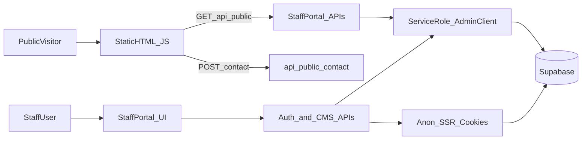

# Kenya Shipyards Limited — Full Website Security Audit Report

**Audit date:** 7 November 2026  
**Scope:** Public static site (`ksl-website`), staff portal (`ksl-website_kiza`), Supabase project, Vercel deployment, GitHub repository  
**Mode:** Read-only assessment (no code, RLS, env, or deployment changes during the audit). One operational Passkeys RP ID fix was applied separately at the user’s request after the audit started and is noted in section H.  
**Auditor role:** Senior application security review (codebase + live Supabase advisors/SQL + safe production smoke checks)

---

## A. Executive Summary

The Kenya Shipyards website is a **two-app architecture**: a static public marketing site on Vercel and a separate Next.js staff portal that owns all content APIs and CMS writes. Database and Auth are on **Supabase**. Overall, the design shows deliberate security work: dual staff sessions, server-side RBAC on CMS APIs, contact-form anti-abuse, published-content filtering on public APIs, and security headers on both surfaces.

**The site can continue operating**, but it is **not free of confirmed issues**. The highest-priority confirmed problems are:

1. **Stored XSS risk in the public press tab** (unescaped CMS fields rendered with `innerHTML`).
2. **Incomplete database lockdown on the live Supabase project** — `public.content_modules` has **RLS disabled**, the private `avatars` bucket from migration `016` is **missing**, and residual table privileges remain for `anon`/`authenticated`.
3. **Anon RLS policies for published content lag the app filters** (`deleted_at` / schedule fields), so direct PostgREST use of the anon key can diverge from the public API.
4. **Dependency and hardening gaps** (npm audit high in PostCSS via Next; public CSP allows `'unsafe-inline'`/`'unsafe-eval'`; CORS allow-list omits the company custom domain).

The **admin/staff portal authentication model is strong in code** (middleware + server `requireStaff` / super-admin checks + idle/single-browser staff cookie). URL obscurity is **not** a security control — the portal hostname is published in every public HTML page via `data-ksl-content-api`.

Public contact and client-side search are comparatively well protected. Staff search is authenticated.

**Coverage limits:** This audit did not attempt credential stuffing, DoS, or unauthorized access to real staff accounts. GitHub branch protection and some Auth dashboard toggles require manual confirmation. Preview deployment protection and GitHub Actions were reviewed from the repo (no workflows present).

---

## B. Application Architecture

### Technologies

| Layer | Technology |
|-------|------------|
| Public site | Static HTML/CSS/JS on Vercel project `ksl-website` |
| Staff portal | Next.js 15 App Router (React 19) on Vercel project `ksl-website_kiza` |
| Database / Auth / Storage | Supabase (Postgres + Auth + Storage) |
| Source control | GitHub (`harry934/KSL-website` per project docs) |

### Component map

### Important communication paths

- **Public site → portal:** `fetch` to `https://ksl-websitekiza.vercel.app/api/public/*` (base URL set in HTML `data-ksl-content-api`).
- **Public site → Supabase:** none for data APIs. Media URLs may point at `*.supabase.co` storage.
- **Portal browser:** Supabase anon key for Auth/passkeys only (`NEXT_PUBLIC_SUPABASE_*`).
- **Portal server:** `SUPABASE_SERVICE_ROLE_KEY` via `createAdminClient()` for CMS and all `/api/public/*` reads/writes.

### Exposed endpoints (summary)

**Public (no staff session):**

- `GET /api/public/{news,events,faq,careers,press,downloads,gallery,services,products,projects,organization,csr,settings,site-images}`
- `GET /api/public/contact-token`
- `POST /api/public/contact`
- Auth bootstrap: `POST /api/auth/sign-in`, `passkey`, `forgot-password`, invite verify/complete/username-check

**Staff-authenticated:** CMS CRUD under `/api/{news,events,...}`, `/api/upload`, `/api/search`, `/api/staff`, etc., gated by middleware + `requireStaff` / super-admin.

### Safe production smoke checks (7 Nov 2026)

| Check | Result |
|-------|--------|
| `GET /api/public/news` | `200` |
| Unauthenticated `GET /api/news` | `401` `{"error":"Please sign in again."}` |
| Empty `POST /api/public/contact` | `400` validation error |
| Public site security headers | HSTS, CSP, X-Frame-Options, nosniff, Referrer-Policy, Permissions-Policy present |

---

## C. Security Findings

### FINDING-001 — Stored XSS via press kit rendering

- **Severity:** HIGH  
- **Affected component:** Public news press tab / press CMS  
- **Paths:** `js/pages/news.js` (approx. lines 306–311); `staff-portal/src/lib/press.ts` (lines 31–35); `staff-portal/src/app/api/press/route.ts` (lines 69–72)  
- **Description:** Press boilerplate, contact email/phone, asset titles, and `href` values are concatenated into `innerHTML` without HTML escaping. Asset `href` is stored without the shared `safeLink` allow-list used elsewhere.  
- **Safe exploit example:** A compromised or malicious staff editor publishes press content with `boilerplate` containing `` or an asset `href` of `javascript:…`. Visitors opening the News press section execute that markup in their browser.  
- **Business impact:** Session theft against visitors is limited (public site has no visitor accounts), but attackers can deface content, phish visitors, or load malware from the corporate site context. Staff-compromised CMS accounts amplify impact.  
- **Remediation:** Escape all press fields client-side (or render with `textContent`); sanitize/allow-list `href` with `safeLink` on save and on public serialization; prefer DOM APIs over `innerHTML`.  
- **Status:** **Confirmed** (code review)

### FINDING-002 — `content_modules` RLS disabled on live database

- **Severity:** HIGH  
- **Affected component:** Supabase table `public.content_modules`  
- **Evidence:** Live `list_tables` / SQL: `rls_enabled = false`. Supabase advisor severity critical. Migration `016_lock_down_api_grants.sql` was intended to enable RLS here but is not fully reflected live. Table currently has **0 rows**.  
- **Description:** Without RLS, defense-in-depth depends entirely on table grants. Live grants for `anon`/`authenticated` on this table are residual `REFERENCES, TRIGGER, TRUNCATE` (SELECT/DML appear revoked), which lowers immediate data-exfil risk but leaves the table outside the project’s stated RLS standard.  
- **Safe exploit example:** If grants were widened later (or a Data API error led someone to `GRANT SELECT`), the table would be fully readable/writable without policies.  
- **Business impact:** Low today (empty table), but high as a posture failure and future foot-gun.  
- **Remediation:** Apply remaining `016` lockdown: `ALTER TABLE public.content_modules ENABLE ROW LEVEL SECURITY;` keep deny-default (no anon policies) + service_role-only access.  
- **Status:** **Confirmed** (live DB)

### FINDING-003 — Migration 016 incomplete: private `avatars` bucket missing

- **Severity:** MEDIUM  
- **Affected component:** Supabase Storage / staff avatars  
- **Evidence:** Live `storage.buckets` lists only `media-public` (public) and `downloads` (private). No `avatars` bucket. Code falls back to `media-public` for avatars (`staff-portal` avatar upload path).  
- **Description:** Staff profile photos may land in the world-readable public media bucket.  
- **Safe exploit example:** Anyone who obtains or guesses an avatar object path can fetch it without authentication.  
- **Business impact:** Staff facial images / identifiers exposed; privacy and social-engineering risk.  
- **Remediation:** Finish applying `016_lock_down_api_grants.sql` (create private `avatars` bucket + policies); migrate existing public avatar objects.  
- **Status:** **Confirmed** (live DB + code)

### FINDING-004 — Anon published-read policies omit soft-delete / go-live filters

- **Severity:** MEDIUM  
- **Affected component:** Supabase RLS on content tables  
- **Paths:** e.g. `supabase/migrations/001_staff_portal_schema.sql` policy `news_public_read` (`status = 'published'` only); live `pg_policies` matches this pattern across news, events, gallery, careers, downloads, etc.  
- **Description:** Portal `/api/public/*` filters recycled / not-yet-live content in application code. Direct PostgREST with the anon key can still return rows that remain `status='published'` but are soft-deleted or scheduled, depending on columns present.  
- **Safe exploit example:** Attacker uses the public anon key against `/rest/v1/news_items?select=*` and reads content the website UI no longer shows.  
- **Business impact:** Premature or recycled content disclosure; confusion; possible internal wording leak.  
- **Remediation:** Tighten RLS `USING` clauses to match API filters (`deleted_at IS NULL`, go-live windows). Prefer removing anon table access entirely if all reads stay on the portal API.  
- **Status:** **Confirmed** (migrations + live policies)

### FINDING-005 — Public `media-public` bucket fully readable

- **Severity:** MEDIUM  
- **Affected component:** Supabase Storage  
- **Paths:** Policy `media_public_read` on `storage.objects`; bucket `public=true`  
- **Description:** Any object in `media-public` is readable if the path is known. Paths appear in public API JSON. Intentional for marketing media, but also covers CMS uploads and legacy avatars.  
- **Safe exploit example:** Enumerate or scrape known/guessable paths from published JSON responses.  
- **Business impact:** Expected for published media; unexpected for staff avatars or unpublished drafts mistakenly uploaded to this bucket.  
- **Remediation:** Keep only intentionally public assets here; private documents stay in `downloads`; avatars in private bucket; audit object inventory.  
- **Status:** **Confirmed**

### FINDING-006 — SECURITY DEFINER `rls_auto_enable` executable by PUBLIC

- **Severity:** MEDIUM  
- **Affected component:** `public.rls_auto_enable()`  
- **Evidence:** Supabase security advisor WARN; SQL shows `SECURITY DEFINER`, execute grantees include `PUBLIC`. Function is an event-trigger helper that enables RLS on new public tables.  
- **Description:** Callable surface exists for anon/authenticated via PostgREST RPC naming. In normal call context it may no-op without event-trigger state, but EXECUTE should still be revoked from PUBLIC/anon/authenticated.  
- **Business impact:** Privilege/attack-surface hygiene; unexpected side effects if callable in some contexts.  
- **Remediation:** `REVOKE EXECUTE ON FUNCTION public.rls_auto_enable() FROM PUBLIC, anon, authenticated;`  
- **Status:** **Confirmed** (live advisors + SQL)

### FINDING-007 — CORS allow-list missing custom production domain

- **Severity:** MEDIUM (availability / future security debt)  
- **Affected component:** `staff-portal/src/middleware.ts` lines 6–25  
- **Description:** Allowed origins are `https://ksl-website.vercel.app`, preview `ksl-website-*.vercel.app`, and localhost. Deploy guides reference `kenyashipyards.co.ke`, which is **not** listed.  
- **Safe exploit example:** N/A for exploit; when the custom domain serves the static site, browser `fetch` to the portal API will fail CORS. Temptation to “fix” with `*` would create a security regression.  
- **Business impact:** Broken contact form / content loading on the company domain unless allow-list (and CSP `connect-src`) are updated carefully.  
- **Remediation:** Add exact HTTPS origins for the custom domain(s); never use `*`. Update public CSP `connect-src` in `vercel.json` the same day.  
- **Status:** **Confirmed** (code vs docs)

### FINDING-008 — Public CSP allows `'unsafe-inline'` and `'unsafe-eval'`

- **Severity:** LOW  
- **Affected component:** Root `vercel.json` Content-Security-Policy  
- **Description:** Public CSP includes `'unsafe-inline'` and `'unsafe-eval'` in `script-src`, weakening XSS mitigations (amplifies FINDING-001). Staff portal CSP is tighter (no `'unsafe-eval'` in production).  
- **Business impact:** Browser CSP does not block many XSS payloads on the public site.  
- **Remediation:** Move toward nonces/hashes; remove `'unsafe-eval'`; reduce inline scripts.  
- **Status:** **Confirmed**

### FINDING-009 — Suspended-account login message enables username enumeration

- **Severity:** LOW  
- **Affected component:** `staff-portal/src/app/api/auth/sign-in/route.ts` lines 81–84 vs generic invalid credential message  
- **Description:** Suspended users receive a distinct error (“Your account is suspended…”), while unknown/wrong password users get a generic invalid message.  
- **Safe exploit example:** Attacker tries usernames; a 403 suspended response confirms a valid staff username.  
- **Business impact:** Aids targeted phishing / password attacks against known staff usernames. Rate limits still apply.  
- **Remediation:** Return the same generic error for suspended, missing, and wrong-password cases; log suspension server-side.  
- **Status:** **Confirmed**

### FINDING-010 — `set_updated_at` function search_path mutable

- **Severity:** LOW  
- **Affected component:** `public.set_updated_at`  
- **Evidence:** Supabase advisor `function_search_path_mutable`  
- **Description:** Trigger helper lacks a fixed `search_path` in the live definition (migration `016` intended to harden helpers).  
- **Business impact:** Classic search_path hijack risk if combined with other privileges; limited by current grants.  
- **Remediation:** `ALTER FUNCTION … SET search_path = public;` (or empty).  
- **Status:** **Confirmed** (advisor)

### FINDING-011 — npm audit: PostCSS high severity via Next.js

- **Severity:** MEDIUM (dependency)  
- **Affected component:** `staff-portal` dependencies  
- **Evidence:** `npm audit` — 8 vulnerabilities (7 moderate, 1 high). High: PostCSS XSS / source map issues (`GHSA-qx2v-qp2m-jg93` and related) under `next`’s nested `postcss`. Suggested force-fix jumps to Next 16 (breaking).  
- **Business impact:** Exploitability in this Next App Router usage is often limited, but the advisory is real and should be tracked.  
- **Remediation:** Upgrade Next on a planned release after testing; avoid blind `npm audit fix --force` on production.  
- **Status:** **Confirmed** (local `npm audit`)

### FINDING-012 — Residual `REFERENCES`/`TRIGGER`/`TRUNCATE` grants to anon

- **Severity:** LOW  
- **Affected component:** Live Postgres grants on many `public` tables  
- **Evidence:** `information_schema.role_table_grants` shows `anon`/`authenticated` retain `REFERENCES, TRIGGER, TRUNCATE` on numerous tables even where SELECT/DML were revoked.  
- **Description:** Incomplete grant lockdown relative to migration `016` intent (`REVOKE ALL … FROM anon, authenticated`).  
- **Business impact:** Low practical risk today; unclean posture.  
- **Remediation:** Re-run or complete grant revoke from `016`.  
- **Status:** **Confirmed** (live SQL)

### FINDING-013 — Leaked-password protection disabled

- **Severity:** INFORMATIONAL / LOW (plan-limited)  
- **Affected component:** Supabase Auth  
- **Evidence:** Advisor `auth_leaked_password_protection` WARN; docs note Pro plan requirement.  
- **Description:** Compromised password checking (HaveIBeenPwned) is off. Portal still enforces length/complexity locally.  
- **Remediation:** Enable when on a plan that supports it; keep strong password policy.  
- **Status:** **Confirmed** (advisor)

### FINDING-014 — Hero / org chart URL hardening inconsistency

- **Severity:** LOW  
- **Affected component:** `js/main.js` (hero `buttonUrl`); `js/pages/organization.js` (chart href)  
- **Description:** Some URL attributes are not run through the same allow-list / escaping used on other pages (`site-images.js` / `safeLink`).  
- **Business impact:** Open-URL / quote-breakout risk if CMS data is hostile.  
- **Remediation:** Reuse `safeLink` / `escapeHtml` consistently.  
- **Status:** **Potential** (code review; requires malicious CMS content)

### FINDING-015 — Service role used for all public API routes

- **Severity:** INFORMATIONAL  
- **Affected component:** `/api/public/*` via `createAdminClient()`  
- **Description:** Correct for filtering, but any bug in a public handler has full DB power. RLS does not constrain the service role.  
- **Remediation:** Keep handlers minimal; shared query helpers; consider a restricted DB role for public reads later.  
- **Status:** **Confirmed** (architecture)

### FINDING-016 — Staff portal hostname discoverable (obscurity only)

- **Severity:** INFORMATIONAL  
- **Affected component:** Public HTML `data-ksl-content-api="https://ksl-websitekiza.vercel.app"`  
- **Description:** Admin URL obscurity is intentional but ineffective as a control. Auth must (and largely does) carry the load.  
- **Remediation:** Continue treating portal security as credential + session + RBAC based; optional Vercel Deployment Protection for non-prod.  
- **Status:** **Confirmed**

---

## D. Supabase Security Assessment

### RLS

| Check | Result |
|-------|--------|
| Most app tables RLS enabled | **Yes** (live) |
| Tables with RLS but no policies (deny-by-default) | 22 tables (expected for staff-only data) — advisor INFO |
| `content_modules` RLS | **Disabled** — FINDING-002 |
| Anon SELECT policies | Present on published content tables; status-only — FINDING-004 |
| Anon write policies | **None** observed in live `pg_policies` |

### API keys

| Key | Exposure |
|-----|----------|
| Anon / publishable | Expected in portal browser (`NEXT_PUBLIC_*`) |
| Service role | Server-only in `staff-portal/src/lib/supabase/admin.ts`; **not** in public `js/` |
| Git tracked secrets | **None** found (`.env*` gitignored; history scan clean for env filenames) |

### Authentication

- Staff use username→internal email mapping + password; invites for onboarding.
- Passkeys enabled; RP ID corrected during this engagement to `ksl-websitekiza.vercel.app` (was wrongly `ksl-websitemink.vercel.app`).
- Leaked-password protection off (plan).
- Public sign-up disablement: **manual verify** (section H).

### Storage

| Bucket | Public | Notes |
|--------|--------|-------|
| `media-public` | Yes | Full SELECT policy for anon/auth |
| `downloads` | No | Portal/service role + signed access |
| `avatars` | **Missing** | FINDING-003 |

### Database functions

- App SECURITY DEFINER helpers (`auth_email_for_username`, counts, storage helpers) execute as **service_role** only — good.
- `rls_auto_enable` still executable by PUBLIC — FINDING-006.
- `set_updated_at` mutable search_path — FINDING-010.

### Grants

SELECT/DML appear largely revoked from anon; residual REFERENCES/TRIGGER/TRUNCATE remain — FINDING-012. Migration **016 is not fully applied** on the live project.

---

## E. Admin Dashboard Assessment

### Is obscurity enough?

**No.** The portal URL is public in site HTML. Treat it as a known endpoint.

### Authentication & sessions

| Control | Assessment |
|---------|------------|
| Middleware requires Supabase user + staff session cookie | Strong |
| Idle timeout (~20m) + single-browser session key | Strong |
| Logout clears DB session + auth | Strong |
| Password policy (≥12, complexity) | Strong |
| Login rate limits (user + IP) | Present |
| Invite + passcode onboarding | Present |
| Server `requireStaff` / super-admin on APIs | Strong — API not UI-only |
| MFA (TOTP) required | Not enforced (would lock users without portal enrollment UX) |

### Can an attacker who finds the URL get in without credentials?

**Not via the reviewed code paths**, assuming:

- Public sign-up remains off in Supabase Auth
- Service role key stays server-only
- Rate limits and invite expiry remain in force

Unauthenticated CMS API probes returned **401** in production smoke tests.

### Weaknesses

- Username enumeration for suspended accounts (FINDING-009)
- No MFA step-up
- Passkey RP misconfiguration had broken passkeys until fixed (ops)

**Verdict:** Admin protection is **sufficient for operation** if dashboard Auth settings stay locked down, but should not be described as “hidden.” Prioritize XSS and DB lockdown over renaming the hostname.

---

## F. Forms and Search Assessment

### Contact form

| Control | Status |
|---------|--------|
| Field clipping / email regex / preferred whitelist | Yes |
| Honeypot | Yes |
| Signed challenge token (min age) | Yes |
| Turnstile (fail closed in production if secret missing) | Code-confirmed |
| Rate limit 5/hour/IP | Yes |
| Outbound email from handler | No (DB insert only) |
| Portal display of messages | Uses safe text rendering |

**Residual:** Client `input-guard` is heuristic; server stores plain text (acceptable if inbox never uses `innerHTML`). Confirm Turnstile secrets exist on Vercel (section H) — env listing during audit showed Supabase-related vars but did not show Turnstile keys by name.

### Public search

Client-side only (static pages + public JSON). Escaping generally applied for suggestions. No server SQL search for visitors. **Not** a direct SQLi surface.

### Staff search (`GET /api/search`)

Requires staff session; module ACL; `safeLike` strips wildcards; length capped. **Adequate.**

### Press / CMS-fed HTML

Primary form/content XSS issue is FINDING-001.

### Spam / abuse

Contact is the main write surface and is rate-limited. Public GETs have no rate limit (cacheable content; DoS not tested).

---

## G. GitHub and Vercel Assessment

### GitHub / repository

| Item | Result |
|------|--------|
| `.env` / secrets tracked | No |
| Git history env filenames | No matches |
| Hardcoded live service-role JWTs | None found |
| GitHub Actions workflows | None in repo |
| Branch protection | **Not verified** (manual) |
| Root dependencies | N/A (static site) |
| Portal `npm audit` | FINDING-011 |

### Vercel

| Item | Result |
|------|--------|
| Project split | Public `ksl-website` vs portal `ksl-website_kiza` |
| `.vercelignore` excludes `/staff-portal` from public deploy | Yes |
| Public headers | Present in `vercel.json` (FINDING-008 for CSP looseness) |
| Portal headers | Present in `next.config.ts` (DENY framing, HSTS, nosniff, noindex) |
| Service role on portal project | Present as sensitive env (name confirmed; value not read) |
| Latest portal git deployment state observed | `BLOCKED` in API metadata while alias still served content — **verify Deployment Protection / billing / Git integration** (manual) |
| Preview protection | Manual |

---

## H. Manual Verification Checklist

### Supabase Dashboard

1. **Authentication → Providers → Email:** Confirm **Allow new users to sign up** is **OFF**.  
2. **Authentication → Passkeys:** Confirm RP ID is exactly `ksl-websitekiza.vercel.app` (no trailing dot), origins `https://ksl-websitekiza.vercel.app`. *(Corrected during this engagement; re-check after any Auth config changes.)*  
3. **Authentication → URL configuration:** Site URL = portal origin; redirect allow-list tight.  
4. **Storage:** Confirm no anon INSERT/UPDATE policies; create/verify private `avatars` after applying `016`.  
5. **Database → Advisors:** Re-run security advisors after remediations.  
6. **SQL:** Confirm `content_modules.relrowsecurity = true` after fix.  
7. **Backups:** Free plan — take periodic dumps; consider Pro for PITR.

### Vercel Dashboard

1. Portal project env: `SUPABASE_SERVICE_ROLE_KEY`, `NEXT_PUBLIC_SUPABASE_URL`, `NEXT_PUBLIC_SUPABASE_ANON_KEY` on Production **and** Preview as needed.  
2. Confirm whether `TURNSTILE_SECRET_KEY` / `NEXT_PUBLIC_TURNSTILE_SITE_KEY` are set (not observed by name in env listing).  
3. Deployment Protection for Preview deployments.  
4. Custom domain plan: update CORS + CSP when attaching `kenyashipyards.co.ke`.  
5. Investigate why latest production deployment shows `BLOCKED` while the production alias still responds.  
6. Ensure GitHub auto-deploy vs CLI deploy process matches team expectations (GitHub deploys often blocked per project rules).

### GitHub

1. Branch protection on `main` (reviews, no force-push).  
2. Secret scanning / Dependabot alerts enabled.  
3. Org/repo access limited to needed collaborators.  
4. No Actions secrets required today (no workflows); if CI is added later, use OIDC / least privilege.

---

## I. Prioritized Remediation Plan

### 1. Immediate — Critical / High

1. **Fix press XSS** (FINDING-001): escape output + `safeLink` on press asset URLs.  
2. **Complete Supabase migration 016** (FINDING-002, 003, 012): enable RLS on `content_modules`, create private `avatars`, revoke residual grants.  
3. **Revoke EXECUTE** on `rls_auto_enable` from PUBLIC/anon/authenticated (FINDING-006).  
4. Confirm Auth **public sign-up is off** and Turnstile secrets are correctly set for production contact.

### 2. Short-term — Medium

1. Align anon RLS with soft-delete / go-live filters, or remove direct anon table reads (FINDING-004).  
2. Inventory `media-public` objects; move avatars off the public bucket (FINDING-005).  
3. Plan Next.js upgrade path for PostCSS advisory (FINDING-011).  
4. Before custom domain cutover, update CORS + CSP (FINDING-007).

### 3. Improvements — Low / Informational

1. Unify login error messages (FINDING-009).  
2. Harden `set_updated_at` search_path (FINDING-010).  
3. Tighten public CSP (FINDING-008).  
4. Consistent URL escaping for hero/org chart (FINDING-014).  
5. Enable leaked-password protection when plan allows (FINDING-013).  
6. GitHub branch protection + Dependabot; clarify Vercel BLOCKED deployments.

**Do not implement these until explicitly approved.**

---

## J. Final Security Verdict

| Question | Answer |
|----------|--------|
| Safe to operate in current state? | **Yes, with caveats** — keep staff credentials strong; prioritize XSS + DB lockdown. |
| Confirmed issues needing immediate attention? | **Yes** — press XSS; incomplete migration 016 / `content_modules` RLS; `rls_auto_enable` EXECUTE; verify Auth signup + Turnstile. |
| Admin dashboard sufficiently protected? | **Yes in code**, assuming Auth signup stays off. Obscurity is not a control. |
| Public forms / search adequately protected? | **Contact: largely yes.** **Press HTML: no.** Search: low risk. |
| Supabase properly secured? | **Mostly, but not fully** — live gaps vs intended `016` posture. |
| Deployment / repository risks? | **Secrets hygiene good.** Dependency audit + Vercel BLOCKED state + missing Actions/branch-protection verification remain. |

### Coverage & limitations

- Strong on: static code review, API inventory, auth middleware design, live RLS/policy/grant/advisor queries, safe smoke tests, header checks, secret-pattern scans.  
- Limited on: full Auth dashboard toggles without UI walkthrough of every screen, GitHub org policy APIs, destructive/dynamic exploitation, preview-env matrix, third-party CDN supply chain beyond CSP allow-lists.

**This is not a clean bill of health.** The application shows mature defensive design for a dual static/CMS stack, but confirmed HIGH findings and incomplete live database lockdown mean remediation should be scheduled before treating the platform as “hardened.”

---

*End of report. No application code remediations were implemented as part of this audit. Await explicit approval before fixes.*
