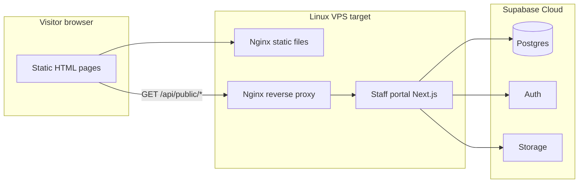

# KSL website — technical overview and VPS production migration

**Audience:** Kenya Shipyards IT, management, and developers.  
**Last updated:** March 2026  

**Related:** [DEPLOYMENT.md](./DEPLOYMENT.md) (current Vercel setup) · [PROJECT-STATUS.md](./PROJECT-STATUS.md) · [../staff-portal/README.md](../staff-portal/README.md) · [../SECURITY_AUDIT_REPORT.md](../SECURITY_AUDIT_REPORT.md)

---

## 1. What this system is

Kenya Shipyards Limited (KSL) runs two connected applications from **one Git repository**:

| Application | Who uses it | Purpose |
|-------------|-------------|---------|
| **Public website** | Visitors, media, partners | Marketing pages: services, products, news, careers, contact, downloads, gallery, and more |
| **Staff portal (admin)** | Authorised KSL staff only | Update website content without editing HTML or database SQL |

**Backend (cloud):** [Supabase](https://supabase.com) hosts PostgreSQL (content), authentication (staff accounts), and file storage (photos, documents uploaded via the portal). The VPS does **not** host the database in the planned production layout.

### How content reaches the public site

1. Staff sign in to the portal, edit a section (e.g. News), and set items to **On website** (published).
2. Each visitor’s browser loads static HTML from the public host, then JavaScript calls the portal’s **read-only public API** (`/api/public/...`) to fill in live content.
3. If the API is unavailable, the same pages fall back to snapshot files in `data/*.json` (last-known-good copy in the repo).

The public site never holds database passwords or the Supabase service role key.



### Current vs target hosting

| Piece | Today (staging / preview) | Target production |
|-------|---------------------------|-------------------|
| Public site | Vercel `ksl-website` → https://ksl-website.vercel.app | **VPS** → `https://www.kenyashipyards.co.ke` |
| Staff portal | Vercel `ksl-website_kiza` → https://ksl-websitekiza.vercel.app | **VPS** → separate hostname (not linked from public menu) |
| Database, auth, media API storage | Supabase project `envqgczfhxywkxcnsxrt` | **Unchanged** (Supabase Cloud) |

---

## 2. Repository layout

| Path | Role |
|------|------|
| `*.html` (repo root) | Public pages; filename = URL path (e.g. `news.html`) |
| `css/` | Bootstrap + `ksl.css` (site styling) |
| `js/` | Shared behaviour; `js/pages/` = one script per page; `js/ksl-content.js` = API client |
| `lib/` | Third-party libraries (carousel, lightbox, WOW.js) — do not edit |
| `img/`, `docs/` | Images/videos and downloadable PDFs linked from the site |
| `data/` | JSON fallbacks when the portal API is down |
| `staff-portal/` | Next.js 15 staff CMS and APIs |
| `supabase/migrations/` | **39** SQL migrations (`001` … `039`) — apply in order on Supabase |
| `guides/` | Team documentation (not deployed to the public web) |

---

## 3. Public website — pages and behaviour

### Pages

| File | Page |
|------|------|
| `index.html` | Home |
| `about.html` | About |
| `organization.html` | Organisation structure |
| `board.html` | Board of directors |
| `service.html` | Services |
| `products.html` | Products |
| `project.html` | Projects |
| `sustainability.html` | Sustainability |
| `csr.html` | Community (CSR) |
| `careers.html` | Careers |
| `news.html` | News list |
| `article.html` | Single news story |
| `event.html` | Events |
| `faq.html` | FAQ |
| `downloads.html` | Downloads |
| `videos.html` | Gallery (photos/videos) |
| `contact.html` | Contact |
| `404.html` | Not found |

### Notable features

- **Live content:** Each page sets `data-ksl-content-api` on `<html>` to the portal origin (no trailing slash). `js/ksl-content.js` fetches `/api/public/*` and falls back to `data/*.json`.
- **Site-wide settings:** Banner under the menu, contact details, hero media — from `/api/public/settings` and related endpoints.
- **Contact form:** Submits to portal `POST /api/public/contact` with **Cloudflare Turnstile** bot protection (`js/main.js`).
- **HTML safety:** User-generated text from the API is sanitised in the browser (`js/sanitize.js`) with rules aligned to the portal editors.
- **Intro animation:** Home page optional intro (`js/intro-boot.js`).
- **Security headers:** On Vercel, `vercel.json` sets CSP, HSTS, and related headers. On VPS, the same policies move to **Nginx** (see section 7).
- **404 handling:** Unknown URLs should serve [`404.html`](../404.html) with HTTP 404. The page uses `<base href="/">` so CSS/JS still load when the browser URL is a **nested** path (e.g. `/old/path/missing`). Vercel: `vercel.json` `routes` after `filesystem`. VPS: Nginx `error_page 404 /404.html`. Missing news/event **slugs** show an in-page message on `article.html` / `event.html` instead of redirecting to `404.html`. Full regression list: [VPS-MIGRATION-CHECKLIST.md](./VPS-MIGRATION-CHECKLIST.md).

---

## 4. Staff portal — modules and APIs

Built with **Next.js 15**, **React 19**, **TypeScript**, **Tailwind CSS 4**, and **TipTap** for rich text.

### Content modules

| Group | Modules |
|-------|---------|
| Publish | News, Events, Gallery, Press kit |
| Catalogue | Services, Products, Projects |
| Organisation | Organisation (chart, board, milestones), Careers, Community (CSR) |
| Library | FAQ, Downloads |
| Inbox | Messages (website contact form) |
| Access | Staff accounts, invites, per-section permissions |
| Website | Site settings, banner, hero media |
| Account | Profile, password, avatar |

### Permissions

For each module, staff may have (unless super admin): **See**, **Change**, **Put live**, **Remove**. Agents without “Put live” save **drafts** only; the public API serves **published** rows.

Other capabilities include: staff invites (6-digit passcode + signup link), draft return workflow, recycle bin, activity log, notifications, global portal search, and media upload/crop/trim tools.

### Public API routes (read-only for visitors)

All under `staff-portal/src/app/api/public/`:

| Endpoint | Content |
|----------|---------|
| `/api/public/news` | News articles |
| `/api/public/events` | Events |
| `/api/public/gallery` | Gallery photos/videos |
| `/api/public/services` | Services |
| `/api/public/products` | Products |
| `/api/public/projects` | Projects |
| `/api/public/careers` | Careers |
| `/api/public/faq` | FAQ |
| `/api/public/csr` | CSR projects |
| `/api/public/downloads` | Download list |
| `/api/public/organization` | Organisation / board data |
| `/api/public/press` | Press kit |
| `/api/public/settings` | Site settings & banner |
| `/api/public/site-images` | Managed site images |
| `/api/public/contact` | Contact form **POST** |
| `/api/public/contact-token` | Turnstile site key for the form |

Responses are cached for roughly **60 seconds** at the edge on Vercel; on VPS, rely on the same application caching headers or add short `proxy_cache` in Nginx if needed.

### Authentication

- Staff sign in with **username and password** (Supabase Auth + custom session cookie).
- **No public sign-up:** new staff are invited by a super admin.
- Middleware (`staff-portal/src/middleware.ts`) protects admin routes and sets CORS on `/api/public/*` for allowed website origins only.
- Portal responses include **`X-Robots-Tag: noindex`** — do not advertise the portal URL on the public site.

---

## 5. Tech stack summary

| Layer | Technology |
|-------|------------|
| Public UI | HTML5, CSS3, jQuery, Bootstrap 5 (vendored under `lib/vendor/` and `css/`) |
| Public data layer | Vanilla JS (`ksl-content.js`, `js/pages/*`) |
| Admin UI | Next.js 15, React 19, TypeScript 5, Tailwind CSS 4 |
| Rich text editors | TipTap 3 |
| Database / auth / files | Supabase (managed Postgres, Auth, Storage) |
| Spam protection | Cloudflare Turnstile (API v0) |
| Version control | Git → https://github.com/harry934/KSL-website |
| Pre-production hosting | Two Vercel projects (see [DEPLOYMENT.md](./DEPLOYMENT.md)) |
| Planned production hosting | One **Linux VPS**: Nginx + Node.js (PM2 or systemd) |

### 5.1 Pinned versions (source of truth)

**Staff portal** — exact install versions come from [`staff-portal/package-lock.json`](../staff-portal/package-lock.json) after `npm ci`. Declared ranges are in [`staff-portal/package.json`](../staff-portal/package.json).

| Component | Version | Notes |
|-----------|---------|--------|
| **Node.js (runtime)** | 18.18+, 19.8+, or 20+ (per Next.js `engines`) | **VPS recommendation:** Node **20 LTS** or **22 LTS** — use the same major version for `npm ci` / `npm run build` on the server. |
| Next.js | **15.5.29** | App Router |
| React / React DOM | **19.1.0** | |
| TypeScript | **5.9.3** | Dev dependency |
| ESLint | **9.39.5** | `eslint-config-next` **15.5.29** |
| Tailwind CSS | **4.3.3** | `@tailwindcss/postcss` **4.3.3** |
| PostCSS (override) | **8.5.6** | `package.json` `overrides` |
| `@supabase/supabase-js` | **2.117.3** | |
| `@supabase/ssr` | **0.12.7** | Cookies / middleware |
| TipTap (`react`, `starter-kit`, `pm`, `extensions`) | **3.32.0** | |
| `sanitize-html` | **2.18.1** | Server-side HTML cleanup |
| `lucide-react` | **1.57.0** | Icons |
| `clsx` | **2.1.1** | |
| `tailwind-merge` | **3.7.0** | |
| `@yusufceng1z/ding-react` | **0.0.2** | Toast UI |
| `@types/node` | **20.19.43** | Types only |

**Public website** — vendored copies in the repo (no `package.json` at root). Loaded via [`js/scripts.js`](../js/scripts.js).

| Component | Version | Path / source |
|-----------|---------|----------------|
| jQuery | **3.7.1** | `lib/vendor/jquery-3.7.1.min.js` |
| Bootstrap (JS bundle) | **5.0.0** | `lib/vendor/bootstrap.bundle.min.js` |
| Bootstrap (CSS) | **5.0.0** | `css/bootstrap.min.css` |
| Owl Carousel | **2.1.6** | `lib/owlcarousel/` |
| Lightbox2 | **2.10.0** | `lib/lightbox/js/lightbox.js` |
| WOW.js | **1.3.0** | `lib/wow/wow.js` |
| Font Awesome (CDN) | **5.10.0** | cdnjs on public HTML |
| Bootstrap Icons (CDN) | **1.4.1** | jsDelivr on public HTML |
| Google Fonts | — | Manrope, Open Sans, Poppins, Roboto (CDN) |

**External services** (versions managed by the provider):

| Service | Role | Versioning |
|---------|------|------------|
| Supabase Cloud | Postgres, Auth, Storage | Project `envqgczfhxywkxcnsrt`; Postgres major version shown in Supabase Dashboard → Database |
| Cloudflare Turnstile | Contact form CAPTCHA | Client: `challenges.cloudflare.com/turnstile/v0/api.js` |
| Google Translate widget | Optional translation | Loaded from Google CDN where enabled |

**Production VPS (recommended, not enforced in code):**

| Component | Recommendation |
|-----------|----------------|
| OS | Ubuntu **22.04** or **24.04** LTS |
| Nginx | Distribution package (e.g. 1.24.x on Ubuntu 24.04) |
| Certbot | `python3-certbot-nginx` from apt |
| Process manager | PM2 **latest** global install, or systemd |

To regenerate the portal lockfile versions after upgrades, run `npm ls` or inspect `package-lock.json` in `staff-portal/`.

### Environment variables (staff portal only)

Create `/var/www/ksl/staff-portal/.env.production` or a systemd drop-in — **never commit** these files.

| Variable | Required | Purpose |
|----------|----------|---------|
| `NEXT_PUBLIC_SUPABASE_URL` | Yes | Supabase project URL |
| `NEXT_PUBLIC_SUPABASE_ANON_KEY` | Yes | Browser-safe Supabase key |
| `SUPABASE_SERVICE_ROLE_KEY` | Yes | Server-only; full API access for writes |
| `NEXT_PUBLIC_PORTAL_URL` | Yes on VPS | Base URL for invite/signup links (e.g. `https://portal-host.example`) |
| `NEXT_PUBLIC_SITE_URL` | Recommended | Public site URL for links in emails/UI (defaults to Vercel if unset) |
| `NEXT_PUBLIC_TURNSTILE_SITE_KEY` | For contact form | Turnstile widget |
| `TURNSTILE_SECRET_KEY` | For contact form | Turnstile server verification |
| `NODE_ENV` | Set by host | `production` on VPS |

On Vercel, `VERCEL_URL` / `VERCEL_PROJECT_PRODUCTION_URL` can substitute for portal URL detection in invites; on VPS set `NEXT_PUBLIC_PORTAL_URL` explicitly.

The **static website** requires **no** environment files on the server.

---

## 6. Database migrations

All scripts live in `supabase/migrations/`. Apply **001 through 039** in filename order in the Supabase SQL editor (or via Supabase CLI / MCP).

Highlights beyond the original schema:

- **014+** Projects and board extensions  
- **029** Staff invites  
- **030–034** Organisation chart, milestones, organogram  
- **036–037** Drafts and draft returns  
- **038** Security lockdown follow-up  
- **039** Projects details  

For a full migration list, list files in `supabase/migrations/` on the repo. [PROJECT-STATUS.md](./PROJECT-STATUS.md) tracks operational checklist items.

---

## 7. VPS production migration runbook

**Decisions for this runbook:**

- **One VPS** serves both the public site and the staff portal.
- **Supabase stays in the cloud** — no self-hosted Postgres.
- Public site: `https://www.kenyashipyards.co.ke` (apex redirects to `www`).
- Portal: **unguessable hostname** (e.g. `https://ksl-staff-XXXXXXXX.kenyashipyards.co.ke` or a separate domain). Staff bookmark `/login`. Do **not** add a portal link to the public navigation or sitemap.

Choose a VPS region close to Supabase if possible (project DB is in **EU**, e.g. `eu-west-1`).

### Phase A — Prepare (no production cutover yet)

1. **Provision VPS:** Ubuntu 24.04 LTS (or 22.04), 2+ vCPU, 4+ GB RAM recommended for Next.js builds.
2. **Create deploy user** with SSH key login; disable password SSH if policy allows.
3. **Firewall:** `ufw allow OpenSSH`, `ufw allow 'Nginx Full'`, `ufw enable`.
4. **Install packages:**
   ```bash
   sudo apt update && sudo apt upgrade -y
   sudo apt install -y nginx certbot python3-certbot-nginx git
   ```
5. **Install Node.js 22+** (NodeSource or nvm). Verify: `node -v` (≥ 22).
6. **Install PM2** (optional but documented here): `sudo npm install -g pm2`.
7. **DNS:** Lower TTL (e.g. 300s). Add **A/AAAA** records:
   - `www.kenyashipyards.co.ke` → VPS IP  
   - `kenyashipyards.co.ke` → VPS IP (for redirect)  
   - Portal hostname → VPS IP  
8. **Supabase dashboard:**
   - Authentication → disable public sign-ups; enable leaked-password protection.  
   - Confirm migrations **001–039** applied.  
   - MFA for super-admin accounts when possible.  
9. **Copy secrets** from Vercel portal project env into a secure note; rotate **service role** if it was ever shared.

### Phase B — Install application on VPS

```text
/var/www/ksl/                 # git clone (repo root = public files)
/var/www/ksl/staff-portal/    # Next.js app
```

```bash
sudo mkdir -p /var/www/ksl
sudo chown "$USER:$USER" /var/www/ksl
git clone https://github.com/harry934/KSL-website.git /var/www/ksl
cd /var/www/ksl/staff-portal
cp .env.example .env.production   # fill in real values locally, never commit
npm ci
npm run build
```

**PM2 (portal on loopback port 3000):**

```bash
cd /var/www/ksl/staff-portal
pm2 start npm --name ksl-portal -- start
pm2 save
pm2 startup   # run the command it prints so PM2 survives reboot
```

**systemd alternative** (`/etc/systemd/system/ksl-portal.service`):

```ini
[Unit]
Description=KSL Staff Portal (Next.js)
After=network.target

[Service]
Type=simple
User=deploy
WorkingDirectory=/var/www/ksl/staff-portal
Environment=NODE_ENV=production
EnvironmentFile=/var/www/ksl/staff-portal/.env.production
ExecStart=/usr/bin/npm run start
Restart=on-failure
RestartSec=5

[Install]
WantedBy=multi-user.target
```

```bash
sudo systemctl daemon-reload
sudo systemctl enable --now ksl-portal
```

### Phase C — Nginx configuration

Replace placeholders:

- `PORTAL_HOST` — portal FQDN (e.g. `ksl-staff-xxxx.kenyashipyards.co.ke`)
- Adjust CSP `connect-src` if the portal hostname differs from the example below.

**Public site** — `/etc/nginx/sites-available/ksl-public`:

```nginx
# Apex → www
server {
    listen 80;
    listen [::]:80;
    server_name kenyashipyards.co.ke;
    return 301 https://www.kenyashipyards.co.ke$request_uri;
}

server {
    listen 80;
    listen [::]:80;
    server_name www.kenyashipyards.co.ke;

    root /var/www/ksl;
    index index.html;

    # After certbot, certbot will add SSL listen 443 blocks or use certbot --nginx

    # Custom 404 body (keep HTTP 404). Requires root-absolute assets on 404.html (<base href="/">).
    error_page 404 /404.html;
    location = /404.html {
        root /var/www/ksl;
        internal;
    }

    location / {
        try_files $uri $uri/ $uri.html =404;
    }

    location ~* ^/img/ {
        expires 30d;
        add_header Cache-Control "public, immutable";
    }

    location ~* \.(mp4|webm)$ {
        add_header Cache-Control 'public, max-age=31536000, immutable';
    }

  location /docs/ {
        expires 7d;
    }

    # Security headers (aligned with repo vercel.json — update connect-src for production portal host)
    add_header X-Content-Type-Options 'nosniff' always;
    add_header X-Frame-Options 'SAMEORIGIN' always;
    add_header Referrer-Policy 'strict-origin-when-cross-origin' always;
    add_header Permissions-Policy 'camera=(), microphone=(), geolocation=(), payment=()' always;
    add_header Strict-Transport-Security 'max-age=63072000; includeSubDomains' always;
    add_header Content-Security-Policy "default-src 'self'; script-src 'self' 'unsafe-inline' https://translate.google.com https://translate.googleapis.com https://www.gstatic.com https://challenges.cloudflare.com; style-src 'self' 'unsafe-inline' https://fonts.googleapis.com https://cdnjs.cloudflare.com https://cdn.jsdelivr.net; font-src 'self' data: https://fonts.gstatic.com https://cdnjs.cloudflare.com https://cdn.jsdelivr.net; img-src 'self' data: blob: https:; media-src 'self' blob: https:; connect-src 'self' https://PORTAL_HOST https://www.kenyashipyards.co.ke https://kenyashipyards.co.ke https://*.supabase.co https://translate.googleapis.com https://translate.google.com https://challenges.cloudflare.com; frame-src https://www.youtube.com https://www.youtube-nocookie.com https://translate.google.com https://challenges.cloudflare.com; frame-ancestors 'self'; object-src 'none'; base-uri 'self'; form-action 'self'" always;
}
```

**Staff portal** — `/etc/nginx/sites-available/ksl-portal`:

```nginx
server {
    listen 80;
    listen [::]:80;
    server_name PORTAL_HOST;

    client_max_body_size 25M;

    location / {
        proxy_pass http://127.0.0.1:3000;
        proxy_http_version 1.1;
        proxy_set_header Host $host;
        proxy_set_header X-Real-IP $remote_addr;
        proxy_set_header X-Forwarded-For $proxy_add_x_forwarded_for;
        proxy_set_header X-Forwarded-Proto $scheme;
        proxy_set_header Upgrade $http_upgrade;
        proxy_set_header Connection "upgrade";
    }
}
```

Enable sites and obtain TLS:

```bash
sudo ln -sf /etc/nginx/sites-available/ksl-public /etc/nginx/sites-enabled/
sudo ln -sf /etc/nginx/sites-available/ksl-portal /etc/nginx/sites-enabled/
sudo nginx -t
sudo systemctl reload nginx
sudo certbot --nginx -d www.kenyashipyards.co.ke -d kenyashipyards.co.ke
sudo certbot --nginx -d PORTAL_HOST
```

Certbot renews via systemd timer; verify with `sudo certbot renew --dry-run`.

### Phase D — Application cutover (code + config)

Deploy these changes in **one release** with DNS:

| Change | Where |
|--------|--------|
| Portal base for browsers | Every public `*.html`: `data-ksl-content-api="https://PORTAL_HOST"` |
| CORS | `staff-portal/src/middleware.ts` → `ALLOWED_ORIGINS` includes `https://www.kenyashipyards.co.ke` and `https://kenyashipyards.co.ke`; add portal host only if needed for same-origin checks |
| Portal env | `NEXT_PUBLIC_PORTAL_URL=https://PORTAL_HOST`, `NEXT_PUBLIC_SITE_URL=https://www.kenyashipyards.co.ke` |
| Turnstile | Cloudflare Turnstile → allowed domains include `www.kenyashipyards.co.ke` |
| Nginx CSP | `connect-src` includes `https://PORTAL_HOST` |

During a short transition you may keep Vercel origins in `ALLOWED_ORIGINS` and CSP so both hosts work until DNS fully moves.

### Phase E — Go-live sequence

1. Deploy to VPS; confirm TLS on both hostnames.
2. **Smoke tests on VPS IP or hosts file** before DNS (see [VPS-MIGRATION-CHECKLIST.md](./VPS-MIGRATION-CHECKLIST.md)):
   - `curl -I https://www.kenyashipyards.co.ke/`
   - `curl -I https://www.kenyashipyards.co.ke/does-not-exist` → **404** and HTML contains `Page not found`
   - Browser: `/foo/bar/missing` → branded 404 (not unstyled / eternal spinner)
   - `curl -s https://PORTAL_HOST/api/public/news | head`
   - Staff login, edit news, publish; refresh public news page.
   - Contact form with Turnstile; message appears in portal Messages.
   - Upload image in gallery; appears on `videos.html`.
3. Switch DNS A/AAAA to VPS.
4. Monitor 24–48h: `sudo tail -f /var/log/nginx/access.log`, `pm2 logs ksl-portal`, Supabase logs/advisors.
5. Keep Vercel projects as cold standby until satisfied, then disable or leave for previews only.

### Phase F — Ongoing operations

**Deploy updates:**

```bash
cd /var/www/ksl
git pull
# Static files: no build — nginx serves immediately

cd staff-portal
npm ci
npm run build
pm2 reload ksl-portal
# or: sudo systemctl restart ksl-portal
```

**Backups:**

- Supabase: use project backups / PITR per your plan.  
- VPS: provider snapshots; optionally rsync `/var/www/ksl/img` and `/var/www/ksl/docs` if large local assets matter.

**What does not move to the VPS:**

- Postgres, Supabase Auth, Storage buckets (remain Supabase Cloud).  
- `staff-portal/vercel.json` region settings (Vercel-only).

---

## 8. Security checklist (production)

- [ ] Service role key only on portal server (env file permissions `600`).  
- [ ] Supabase sign-ups disabled; invite-only staff.  
- [ ] Portal hostname not linked from public site; `noindex` on portal.  
- [ ] `ALLOWED_ORIGINS` and CSP `connect-src` match real public + portal hosts.  
- [ ] Turnstile enabled for contact form in production.  
- [ ] SSH keys only; firewall 22/80/443.  
- [ ] TLS certificates auto-renew.  
- [ ] Super admin MFA in Supabase when available.  

See also [guides/security/](./security/) and [SECURITY_AUDIT_REPORT.md](../SECURITY_AUDIT_REPORT.md).

---

## 9. Local development (quick reference)

| App | Command | URL |
|-----|---------|-----|
| Portal | `cd staff-portal && npm run dev` | http://localhost:3000/login |
| Public site | Static server at repo root | e.g. `npx serve .` |

For local API testing, set on a page:

```html
data-ksl-content-api="http://localhost:3000"
```

---

## 10. Document history

| Date | Notes |
|------|--------|
| March 2026 | Initial production overview + VPS runbook (migrations through 039, Projects module, Turnstile contact) |
